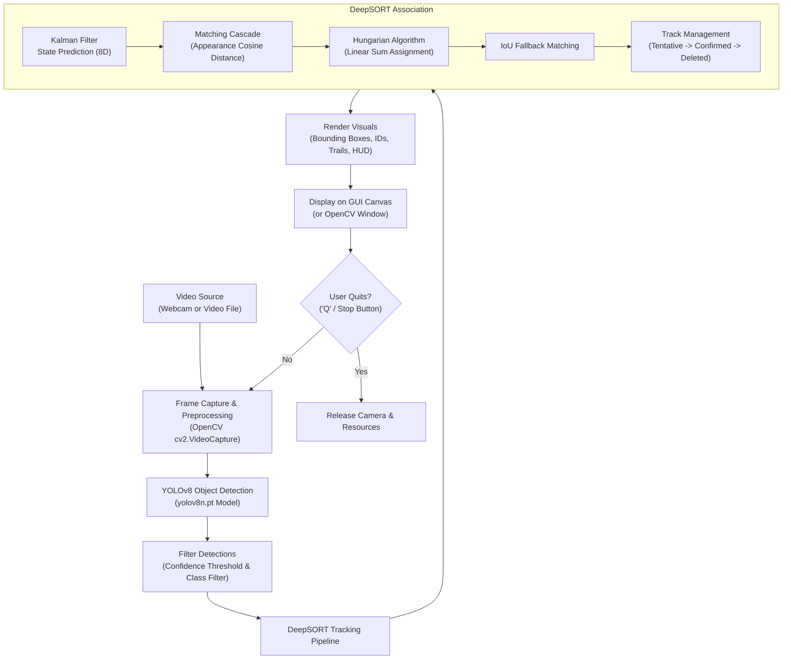

# AI Object Detection and Tracking System


-00ffff.svg)


A complete, production-grade **Object Detection and Multi-Object Tracking (MOT) System** developed for the **CodeAlpha Artificial Intelligence Internship.

The application detects multiple simultaneous objects in real-time from either a **live webcam** or a **video file**, draws stylish corner-bracket bounding boxes, displays object classes and confidence scores, maintains **persistent unique tracking IDs** across frames using the **DeepSORT** algorithm, and visualizes **motion trajectory trails**.

---

## Table of Contents
1. [Project Overview](#project-overview)
2. [Complete System Workflow](#complete-system-workflow)
3. [How YOLOv8 Detects Objects](#how-yolov8-detects-objects)
4. [How DeepSORT Tracks Objects](#how-deepsort-tracks-objects)
5. [User Interface & Key Features](#user-interface--key-features)
6. [Project Structure](#project-structure)
7. [Installation & Setup](#installation--setup)
8. [How to Run the Project](#how-to-run-the-project)
9. [Sample Testing Instructions](#sample-testing-instructions)
10. [Error Handling & Edge Cases](#error-handling--edge-cases)

---

## Project Overview

Multi-object tracking is a foundational computer vision challenge where an algorithm must not only detect objects in isolated video frames, but also **maintain temporal identity** (assigning and preserving unique IDs) as targets move, cross paths, undergo partial occlusions, or temporarily exit and re-enter the field of view.

### Key Capabilities:
- **Real-Time Detection:** Powered by a lightweight pre-trained **YOLOv8n** model trained on the 80-class COCO dataset (persons, cars, buses, bikes, dogs, etc.).
- **Robust Identity Persistence:** Powered by **DeepSORT** (Kalman filtering + cosine distance appearance matching + Hungarian data association).
- **Smooth Trajectory Trails:** Draws fading motion history paths for each active target, visually demonstrating trajectory estimation.
- **Modern Dark-Themed GUI:** Built with Python's built-in `tkinter` and `Pillow`, featuring live counters for Active Objects, Total Track IDs, Real-Time FPS, and Class breakdown.
- **Dual Execution Modes:**
  - **Interactive GUI Mode:** Full user interface with source selection, confidence sliders, class filters, and start/stop controls.
  - **CLI / OpenCV Mode:** Ultra-low-latency direct window execution (`--no-gui` / `--source`).
- **Zero Paid Dependencies:** Runs completely locally with open-source libraries and automatic model downloading.

---

## Complete System Workflow

The tracking pipeline processes video frames through a staged pipeline:



### Step-by-Step Processing:
1. **Frame Capture:** OpenCV reads frames from either the webcam device index (`0`) or an input video file (`.mp4`, `.avi`, `.mov`, `.mkv`).
2. **Object Detection:** YOLOv8 analyzes the frame in a single forward pass, predicting bounding boxes $[x_1, y_1, x_2, y_2]$, confidence scores $c \in [0, 1]$, and class IDs $k \in \{0, \dots, 79\}$.
3. **Filtering:** Boxes below the user-selected confidence threshold or outside target class groups (e.g., Vehicles Only, Persons Only) are filtered out.
4. **Motion Prediction (Kalman Filter):** DeepSORT propagates the 8-dimensional state vector of existing tracks to estimate where targets are expected to be in the current frame.
5. **Data Association:** The Hungarian algorithm (`scipy.optimize.linear_sum_assignment`) pairs detections with existing tracks using a two-stage cascade:
   - *Stage 1 (Appearance):* Cosine distance between detection visual embeddings and track appearance galleries, gated by Mahalanobis distance.
   - *Stage 2 (Spatial Overlap):* Intersection-over-Union (IoU) matching for remaining unmatched detections and tentative tracks.
6. **Track Maintenance:** Matched tracks update their Kalman filters and appearance galleries. Unmatched detections initiate new `Tentative` tracks. Tracks unseen for `max_age` (30 frames) are deleted.
7. **Visualization:** The system renders corner-accented bounding boxes, track ID badges, trajectory trails, and a real-time HUD bar before presenting the frame on the GUI canvas.

---

## How YOLOv8 Detects Objects

**YOLO** (*You Only Look Once*) revolutionized computer vision by reframing object detection from a slow, multi-stage region proposal pipeline (like R-CNN) into a single regression problem solved in one forward pass through a convolutional neural network.

```
Input Image ──► Backbone (CSPDarknet) ──► Neck (PANet) ──► Decoupled Head ──► [Boxes, Scores, Classes]
```

### Core Architecture Concepts:
1. **Single-Stage Detection:** Unlike two-stage detectors that first propose regions and then classify them, YOLO processes the entire image simultaneously, allowing it to incorporate global contextual information and run at high frame rates.
2. **Backbone (Feature Extraction):** Uses an optimized CSPDarknet structure with C2f (cross-stage partial with two convolutions) modules to extract rich semantic features across multiple spatial resolutions (P3, P4, P5).
3. **Neck (Multi-Scale Feature Fusion):** A Path Aggregation Network (PANet) / Feature Pyramid Network (FPN) fuses high-level semantic features with low-level high-resolution spatial details, allowing accurate detection of both tiny and large objects.
4. **Anchor-Free Decoupled Head:** YOLOv8 separates classification and regression into independent branches:
   - *Classification Branch:* Predicts class probabilities using Binary Cross-Entropy (BCE).
   - *Bounding Box Regression Branch:* Directly predicts bounding box distances from grid cell anchors using Distribution Focal Loss (DFL) and Complete IoU (CIoU) loss.
5. **Non-Maximum Suppression (NMS):** Eliminates overlapping candidate boxes for the same object, preserving only the box with the highest confidence score.

### Why YOLOv8n (Nano)?
- **Parameters:** ~3.2 Million (extremely compact).
- **Computation:** ~8.7 GFLOPs.
- **Latency:** Runs comfortably at 25–40 FPS on standard modern laptops without requiring dedicated GPU hardware.

---

## How DeepSORT Tracks Objects

**DeepSORT** (*Deep Simple Online and Realtime Tracking*) extends the original SORT algorithm by integrating deep visual appearance descriptors with Kalman filtering and Hungarian matching.

```
Detections (t)  ─────┐
                     ▼
Existing Tracks ──► [Kalman Predict] ──► [Matching Cascade (Cosine)] ──► [IoU Fallback] ──► [Track Update / Init]
```

### 1. Motion State Estimation (Kalman Filter)
DeepSORT models the spatial state of each bounding box using an 8-dimensional continuous state vector:
$$\mathbf{x} = [u, v, \gamma, h, \dot{u}, \dot{v}, \dot{\gamma}, \dot{h}]^T$$
- $(u, v)$: Center coordinates of the bounding box.
- $\gamma = w / h$: Aspect ratio of the box.
- $h$: Bounding box height.
- $(\dot{u}, \dot{v}, \dot{\gamma}, \dot{h})$: Respective velocities in image space.

At each frame:
- **Prediction:** The filter extrapolates target positions using a constant-velocity linear motion model $\bar{\mathbf{x}} = \mathbf{F} \mathbf{x}$.
- **Update:** When a measurement $\mathbf{z} = [u, v, \gamma, h]^T$ is associated with a track, the Kalman gain $\mathbf{K}$ balances motion prediction uncertainty with detector noise to compute an optimal updated state.

### 2. Deep Appearance Descriptor (Re-ID)
To handle occlusions where motion prediction alone fails:
- Visual features $\mathbf{f} \in \mathbb{R}^{D}$ are extracted for each detected bounding box.
- Each track maintains an appearance gallery of recent feature vectors $\mathcal{R}_i = \{\mathbf{f}_i^{(1)}, \dots, \mathbf{f}_i^{(N)}\}$.
- The similarity between detection $j$ and track $i$ is calculated using the minimum **cosine distance**:
$$d(i, j) = \min \{ 1 - \mathbf{f}_j^T \mathbf{f}^{(k)} \mid \mathbf{f}^{(k)} \in \mathcal{R}_i \}$$

### 3. Mahalanobis Gating
Associations that are geometrically implausible are ruled out using the squared Mahalanobis distance between predicted measurement and detection:
$$d^{(M)}(i, j) = (\mathbf{d}_j - \bar{\mathbf{y}}_i)^T \mathbf{S}_i^{-1} (\mathbf{d}_j - \bar{\mathbf{y}}_i) \le t^{(M)}$$
where $\mathbf{S}_i$ is the innovation covariance and $t^{(M)} = 9.4877$ is the 95% threshold from the $\chi^2$ distribution with 4 degrees of freedom.

### 4. Matching Cascade
Rather than matching all tracks simultaneously, DeepSORT prioritizes tracks that were seen more recently:
1. Matches tracks with `time_since_update == 1`, then `2`, up to `max_age`.
2. Solves the assignment problem via the **Hungarian Algorithm** (`scipy.optimize.linear_sum_assignment`).
3. For tracks and detections remaining unmatched, it falls back to an **IoU (Intersection-over-Union)** distance association.

### 5. Track State Management
- **Tentative:** Newly initiated tracks. They must receive $N_{init} = 3$ consecutive detections before confirmation to prevent false-alarm clutter.
- **Confirmed:** Stable active tracks assigned a persistent unique `track_id`.
- **Deleted:** Tracks unobserved for $MaxAge = 30$ frames are terminated.

---

## User Interface & Key Features

The project features a sleek, responsive dark-themed interface built using Python's native `tkinter` and `Pillow`:

| Section | Description |
| :--- | :--- |
| **Header Bar** | Shows title, internship details, and system description. |
| **1. Video Source** | Radio toggles between **Live Webcam** (with device index selector) and **Video File** (with file browser and demo video loader). |
| **2. Detection & Tracking** | **Confidence Threshold Slider** ($0.10$ to $0.95$), **Target Class Dropdown** (All, People, Vehicles, Animals, Common), and display toggles for **Motion Trails** and **Confidence Scores**. |
| **3. Controls** | Big **▶ START TRACKING** (Emerald) and **⏹ STOP TRACKING (Q)** (Crimson) buttons. |
| **4. Real-Time Metrics** | Live stat cards displaying **Active Objects**, **Total Track IDs**, **Processing FPS**, and **System Status** (`READY`, `RUNNING`, `STOPPED`). |
| **Video Canvas** | Centered high-resolution display with aspect-ratio scaling, sleek welcome graphics, corner-bracket bounding boxes, and HUD bar. |

---

## Project Structure

```
Object_Detection_Tracking/
│
├── main.py                     # Main application (GUI, CLI, Engine, Rendering)
├── run.bat                     # 1-Click Windows Batch Launcher
├── requirements.txt            # Pinned Python package dependencies
├── README.md                   # Comprehensive project documentation
│
├── models/
│   └── yolov8n.pt              # Pre-trained YOLOv8n model (auto-downloaded)
│
├── sample_videos/
│   ├── sample_traffic.mp4      # Ready-to-use sample video for testing
│   └── generate_sample.py      # Automated sample video downloader/generator
│
└── deep_sort/                  # Self-contained DeepSORT tracking engine
    ├── __init__.py             # Package initializer
    ├── tracker.py              # DeepSortTracker orchestrator
    ├── track.py                # Single target track state machine & history
    ├── kalman_filter.py        # 8D state Kalman filter implementation
    ├── linear_assignment.py    # Hungarian algorithm & matching cascade
    ├── nn_matching.py          # Nearest neighbor appearance cosine metric
    └── detection.py            # Bounding box & detection data container
```

---

## Installation & Setup

### 1. Prerequisites
- Python 3.8 to 3.13 installed on your system.
- Webcam (optional, for live camera testing) or sample video.

### 2. How to Open the Terminal
You can use any of the following methods to open the terminal in the project directory:

- **Inside VS Code:** Press **`Ctrl + ~`** (or go to menu **Terminal > New Terminal**).
- **Windows File Explorer:** Click on the file explorer address bar, type `powershell` or `cmd`, and press **Enter**.
- **Run Dialog:** Press **`Win + R`**, type `powershell`, and run:
  ```powershell
  cd "c:\Users\ASUS\Documents\CodeAlpha_Object_Detection_and tracking_System"
  ```

### 3. Create a Virtual Environment (Optional but Recommended)
```bash
python -m venv venv

# Windows (PowerShell):
.\venv\Scripts\activate

# Windows (Command Prompt):
venv\Scripts\activate.bat

# Linux / macOS:
source venv/bin/activate
```

> [!TIP]
> If PowerShell gives an execution policy error on `activate`, run:
> ```powershell
> Set-ExecutionPolicy -Scope Process -ExecutionPolicy Bypass
> .\venv\Scripts\activate
> ```

### 4. Install Dependencies
Install all required libraries using `pip`:
```bash
pip install -r requirements.txt
```

*(Note: PyTorch, OpenCV, Ultralytics, DeepSORT, SciPy, NumPy, and Pillow will be installed).*

---

## How to Run the Project (Step-by-Step Terminal Guide)

### Method 1: Launch Interactive Dark GUI (Recommended for Demonstration)
In your terminal, simply execute:
```bash
python main.py
```
*(If your system uses Python launcher, you can also run `py main.py` or double-click `run.bat`).*

**Inside the GUI:**
1. Select **Live Webcam** (Index `0`) or **Video File**.
2. Click **📁 Browse Video** (or click **🎬 Demo Video** to instantly load the included demo clip).
3. Adjust the **Confidence Threshold** slider (default: `0.40`).
4. Select a **Target Class Filter** (e.g., *Vehicles*, *People Only*, or *All Classes*).
5. Click **▶ START TRACKING**.
6. Press **'Q'** or **Esc** on your keyboard (or click **⏹ STOP TRACKING**) anytime to stop.

---

### Method 2: Launch with Windows Batch Script (No Typing Needed)
Simply double-click **`run.bat`** in the project folder, or run in terminal:
```cmd
run.bat
```

---

### Method 3: Run High-Performance CLI / OpenCV Mode (Direct Video Tracking)
You can launch detection and tracking directly from the terminal without opening the Tkinter GUI:

#### 1. Track the Included Traffic Demo Video:
```bash
python main.py --source sample_videos/sample_traffic.mp4
```

#### 2. Track Live Webcam Feed (Default Camera 0):
```bash
python main.py --source 0
```

#### 3. Filter for Vehicles Only with Custom Confidence:
```bash
python main.py --source sample_videos/sample_traffic.mp4 --conf 0.35 --class-filter "Vehicles (Cars, Buses, Bikes)"
```

#### 4. Filter for People Only:
```bash
python main.py --source 0 --conf 0.45 --class-filter "People Only"
```

#### 5. Disable Motion Trajectory Trails (Clean Bounding Boxes):
```bash
python main.py --source sample_videos/sample_traffic.mp4 --no-trails
```

#### 6. Run Headless / Force OpenCV Window:
```bash
python main.py --source sample_videos/sample_traffic.mp4 --no-gui
```

> [!NOTE]
> When running in OpenCV window mode, press **`q`** or **`ESC`** on your keyboard inside the video window to quit.

---

### Summary of Useful Terminal Commands:

| Task | Terminal Command |
| :--- | :--- |
| **Open GUI Application** | `python main.py` |
| **1-Click Batch Runner** | `.\run.bat` |
| **Track Demo Traffic Video** | `python main.py --source sample_videos/sample_traffic.mp4` |
| **Track Live Webcam** | `python main.py --source 0` |
| **View All CLI Options / Help** | `python main.py --help` |
| **Reinstall Dependencies** | `pip install -r requirements.txt` |
| **Generate / Reset Sample Video** | `python sample_videos/generate_sample.py` |

---

## Sample Testing Instructions

### Test 1: Verification with Sample Video
1. Run `python main.py`.
2. Click the **🎬 Demo Video** button in the left panel.
3. The file `sample_traffic.mp4` will be automatically selected.
4. Click **▶ START TRACKING**.
5. Observe:
   - Cars moving across the road are assigned unique tracking IDs (`ID: #1`, `ID: #2`, etc.).
   - Moving vehicles leave colorful, fading trajectory trails behind their centroids.
   - When one car temporarily occludes another, each car maintains its unique ID upon emerging.
   - The Active Objects, Total Track IDs, and FPS counters update in real time.

### Test 2: Live Webcam Demonstration
1. In the left panel, select **Live Webcam** (Device Index: `0`).
2. Click **▶ START TRACKING**.
3. Move in front of the camera:
   - The system detects you as `person` and assigns an ID (e.g., `ID: #1`).
   - Move around the frame — your trajectory trail will follow your movement.
   - Bring common household items (e.g., a cell phone, backpack, bottle, or dog) into the camera view to see multi-class simultaneous tracking.
4. Press **'Q'** to stop.

---

## Error Handling & Edge Cases

The project incorporates industrial-strength fault tolerance:

| Edge Case | How It Is Handled |
| :--- | :--- |
| **Missing Model File** | If `models/yolov8n.pt` is not present, `ensure_model_exists()` automatically downloads it from official Ultralytics releases. |
| **Unavailable / Blocked Webcam** | If index `0` is disconnected or held by Zoom/Teams, `cap.isOpened()` catches the failure and shows an informative error dialog instead of crashing. |
| **Invalid Video Path** | File paths are verified with `os.path.exists()` before opening, alerting the user gracefully if the file is missing or corrupted. |
| **Missing Third-Party Libraries** | If `deep-sort-realtime` encounters environment issues (such as `pkg_resources` deprecation in Python 3.12+), the system seamlessly falls back to the native built-in `deep_sort` module. |
| **Single-Frame Misclassifications** | The tracker uses historical class voting so a transient single-frame detector fluctuation does not flip an object's established label. |
| **End of Video Stream** | Video files automatically loop seamlessly for continuous, unattended project demonstrations. |

---
---


